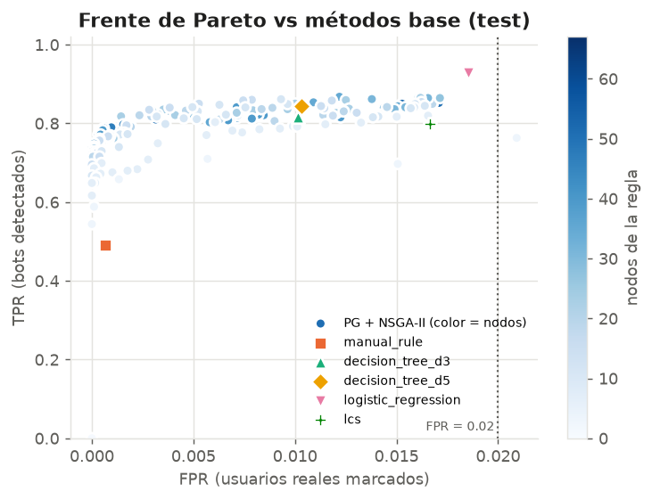
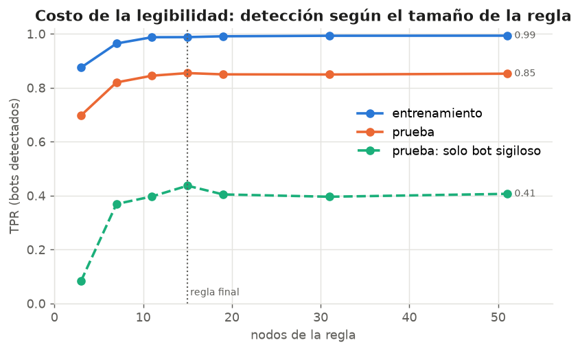
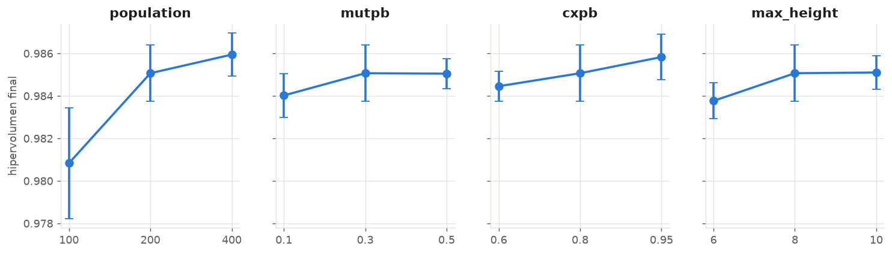

# gp-bot-detection-rules

Reglas interpretables de detección de bots evolucionadas con Programación Genética y compiladas a SQL (dbt + DuckDB). Proyecto final de Computación Evolutiva, MAE-IA UNI 2026-II.

**Curso:** MAE-IA Computación Evolutiva (2026-II), Universidad Nacional de Ingeniería

## Descripción

Una plataforma social con chat en tiempo real y descubrimiento de usuarios por
geolocalización recibe spam de cuentas automatizadas que superan captcha y
filtros básicos. Este proyecto hace **evolucionar reglas lógicas legibles** que
detectan esos bots, por ejemplo (ilustrativo, no es un resultado):

```sql
(msgs_per_min > 0.42) AND ((reply_rate < 0.08) OR (account_age_hours < 31.5))
```

y las **compila a SQL** para ejecutarlas como modelos de dbt sobre el mismo
warehouse que calcula las features.

- **Algoritmo:** Programación Genética tipada + NSGA-II (DEAP).
- **Objetivos:** maximizar bots detectados (TPR), minimizar usuarios reales
  marcados (FPR) y minimizar el tamaño de la regla, con la restricción `FPR ≤ 2 %`.
- **Datos:** 100 % sintéticos, generados por un simulador basado en agentes
  (usuarios reales, bot ingenuo, bot adaptativo y un bot sigiloso que solo
  aparece en prueba para medir generalización). No se usan datos de usuarios reales.

## Hallazgos principales

Resultados de la corrida base (semilla 42). Todos los métodos se ajustan solo
con entrenamiento; el escenario de prueba incluye un bot sigiloso que nunca
vieron. Análisis completo en [`notebooks/01_analisis.ipynb`](notebooks/01_analisis.ipynb).

| Método | Tamaño | TPR train | FPR train | TPR test | FPR test | TPR bot sigiloso |
|---|---|---|---|---|---|---|
| **PG + NSGA-II (regla final)** | 15 nodos | 0,988 | 0,020 | **0,854** | 0,016 | 0,437 |
| PG un objetivo | 15 nodos | 0,965 | 0,002 | 0,827 | 0,002 | 0,373 |
| Regla manual | 15 nodos | 0,625 | 0,001 | 0,491 | 0,001 | 0,000 |
| Árbol de decisión (prof. 3) | 15 nodos | 0,971 | 0,011 | 0,816 | 0,010 | 0,334 |
| Árbol de decisión (prof. 5) | 59 nodos | 0,990 | 0,011 | 0,845 | 0,010 | 0,384 |
| Regresión logística | 10 coeficientes | 0,998 | 0,020 | 0,927 | 0,019 | 0,690 |
| LCS | 39 condiciones | 0,932 | 0,017 | 0,798 | 0,017 | 0,328 |

- Con 15 nodos, la regla evolucionada iguala en prueba al árbol de decisión de
  59 nodos y supera al árbol de su mismo tamaño.
- La regresión logística detecta más (sobre todo del bot no visto), pero no es
  una regla que se pueda leer ni editar.
- Todos los métodos pierden detección en prueba, casi toda por el bot sigiloso.
- Alargar la regla más allá de 15 nodos mejora el entrenamiento (0,988 → 0,993
  con 51 nodos) pero no la prueba (0,854 → 0,852).



## Mejor regla encontrada

```sql
((account_age_hours < 530.2) AND ((link_ratio > 0) OR (avg_msg_len > 30.35))) AND (reply_rate < 0.3333)
```

En lenguaje de negocio: marca la actividad de una **cuenta con menos de 22
días** a la que **responde menos de un tercio** de las personas a las que
escribió en esa hora, y que **envía enlaces o mensajes de más de 30 caracteres
en promedio**.

| Escenario | TPR | FPR | Bot ingenuo | Bot adaptativo | Bot sigiloso |
|---|---|---|---|---|---|
| Entrenamiento | 0,988 | 0,020 | 1,000 | 0,960 | — |
| Prueba | 0,854 | 0,016 | 1,000 | 0,935 | 0,437 |

La regla se elige solo con entrenamiento (mayor TPR con `FPR ≤ 2 %` y a lo sumo
15 nodos) y se exporta como modelo de dbt en
[`dbt_project/models/moderation/`](dbt_project/models/moderation/). El SQL
exportado marca en DuckDB exactamente las mismas filas que la regla evaluada
en Python.



## Conclusiones

1. La Programación Genética tipada con NSGA-II encuentra reglas cortas y
   legibles que cumplen la restricción de falsos positivos y detectan casi
   todos los bots conocidos.
2. No es el método con más detección: la regresión logística la supera. Lo que
   aporta es una regla que un moderador puede leer, auditar y desplegar como SQL.
3. El frente de Pareto permite decidir después cuánta detección se cambia por
   legibilidad; la versión de un objetivo obliga a fijar esos pesos antes.
4. El problema central del diseño fue la diversidad. El diseño inicial se
   estancaba en reglas de una sola comparación (hipervolumen 0,880); eliminar
   clones o agregar una mutación de crecimiento lo corrige (0,983–0,985).
5. La generalización a un bot no visto es limitada en todos los métodos: las
   reglas necesitan monitoreo y volver a evolucionarse.

Limitaciones: los datos son simulados y sus parámetros son supuestos, no
mediciones; hay una sola partición entrenamiento / prueba; el estudio de
sensibilidad no mide interacciones entre parámetros.

## Arquitectura

```
[sim] ──Parquet──> [dbt + DuckDB] ──features──> [evo: PG tipada + NSGA-II]
                                                     │ frente de Pareto
                                                     ▼
                                     [árbol → SQL] ──> dbt_project/models/moderation/*.sql
                                                     │
                                                     ▼
                                     [report: figuras y tablas para el informe]
```

| Carpeta | Contenido |
|---|---|
| `simulator/` | Simulador basado en agentes → `data/raw/<escenario>/*.parquet` |
| `dbt_project/` | Staging y features (`fct_user_activity_hourly`) en DuckDB; reglas exportadas en `models/moderation/` |
| `evo/` | Primitivas, evaluación, aptitud, NSGA-II, compilador SQL, sensibilidad y reportes |
| `baselines/` | Regla manual, árbol de decisión, regresión logística, LCS |
| `experiments/` | Configuraciones YAML (corrida base y estudio de sensibilidad) |
| `openspec/` | Especificaciones (desarrollo guiado por specs) |
| `results/` | `runs/` (no versionado), `figures/` y `tables/` (sí versionados) |

## Cómo ejecutar

Requisitos: Docker y Docker Compose.

```bash
make build        # construye la imagen
make data         # simula los escenarios train y test
make features     # dbt build sobre DuckDB (features + tests de datos)
make evolve       # una corrida (experiments/base.yaml)
make evolve-single  # misma PG con un solo objetivo (referencia)
make baselines    # métodos de referencia
make report       # figuras y tablas en results/
make test         # tests

make all          # data + features + evolve + evolve-single + baselines + report
make sensitivity  # estudio de sensibilidad (45 corridas)
make ablation     # con y sin eliminación de clones y mutación de crecimiento (20 corridas)
make export RUN_ID=<id>   # exporta la regla final a dbt y la ejecuta
make analysis     # ejecuta notebooks/01_analisis.ipynb y guarda sus salidas
make notebook     # JupyterLab en http://localhost:8888
```

Las corridas son reproducibles: la misma configuración y semilla producen el
mismo registro por generación y el mismo frente.

Parámetros puntuales sin editar el YAML:

```bash
docker compose run --rm evo python -m evo.run --config experiments/base.yaml \
  --set algorithm.population=400 --set seed=3
```

## Parámetros del algoritmo (configuración base)

| Parámetro | Valor |
|---|---|
| Representación | Árbol tipado (`bool`, `Feature`, `Quantile`) |
| Primitivas | `and_`, `or_`, `not_`, `gt(feature, q)`, `lt(feature, q)` |
| Umbrales | cuantil `q ∈ [0.01, 0.99]` de la feature en entrenamiento |
| Población (μ) | 200 |
| Generaciones | 150 |
| Prob. cruce | 0.8 (intercambio de subárboles) |
| Prob. mutación | 0.3 (subárbol 30 %, nodo 20 %, umbral 25 %, crecimiento 25 %) |
| Selección | NSGA-II (μ+λ) sin clones, torneo por dominancia y crowding |
| Altura máxima | 8 |
| Restricción | `FPR ≤ 0.02`, penalización `λ = 5` |
| Regla final | mayor TPR en entrenamiento con `FPR ≤ 0.02` y a lo sumo 15 nodos (no usa la prueba) |
| Hipervolumen | referencia fija `(TPR = 0, FPR = 1, 511 nodos)` |
| Semillas (sensibilidad) | 1, 2, 3, 4, 5 |

## Estudio de sensibilidad

Diseño "uno a la vez" sobre población, prob. de mutación, prob. de cruce y
altura máxima: 9 configuraciones × 5 semillas = 45 corridas
(`results/tables/sensitivity.csv`).

| Parámetro | Valores | Hipervolumen final (media) |
|---|---|---|
| Población | 100 / **200** / 400 | 0,9808 / 0,9851 / 0,9859 |
| Prob. mutación | 0,1 / **0,3** / 0,5 | 0,9840 / 0,9851 / 0,9850 |
| Prob. cruce | 0,6 / **0,8** / 0,95 | 0,9845 / 0,9851 / 0,9858 |
| Altura máxima | 6 / **8** / 10 | 0,9838 / 0,9851 / 0,9851 |

En negrita, la configuración base. La población es el parámetro con más efecto
y más costo (2,4 s, 7,5 s y 24,5 s por corrida). El TPR en prueba de la regla
final queda entre 0,840 y 0,857 en todas las configuraciones, con diferencias
menores que la variación entre semillas (hasta 0,020).



La ablación (`make ablation`, `results/tables/ablation.csv`) compara el diseño
inicial con los dos mecanismos agregados después de la primera corrida:

| Variante | Hipervolumen final | TPR test de la regla final |
|---|---|---|
| Con clones, sin crecimiento (diseño inicial) | 0,880 | 0,697 |
| Con clones, con crecimiento | 0,983 | 0,845 |
| Sin clones, sin crecimiento | 0,985 | 0,839 |
| Sin clones, con crecimiento (configuración base) | 0,985 | 0,848 |

## Desarrollo guiado por specs (OpenSpec)

Cada componente se especificó antes de implementarse en `openspec/changes/`:

| Cambio | Capacidad | Fase del curso |
|---|---|---|
| `setup-project-infrastructure` | Docker, Makefile, tests | transversal |
| `add-behavior-simulator` | simulador de agentes | I |
| `add-feature-pipeline` | features en dbt + DuckDB | I, III |
| `add-gp-rule-evolution` | PG tipada + NSGA-II | II, III |
| `add-sql-rule-compiler` | árbol → SQL / dbt | IV |
| `add-experiments-and-baselines` | sensibilidad, métodos base, figuras | III, IV |
| `fix-degenerate-first-run` | frases comunes en el simulador, población sin clones, mutación de crecimiento | I, II, IV |
| `select-final-rule-on-train` | regla final elegida solo con entrenamiento y con tope de tamaño | IV |

Ver [`AGENTS.md`](AGENTS.md) para el flujo de trabajo.

## Autor

Renzo — Maestría en Inteligencia Artificial, UNI.
